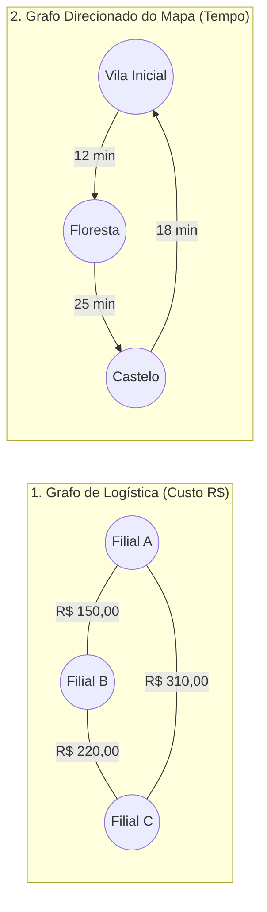

# 🕸️ Teoria dos Grafos — Malha Logística & Mapas Ponderados em C/C++


Implementação prática de **Grafos Ponderados representados por Matrizes de Adjacência** em **C/C++**, desenvolvida no curso de **Ciência da Computação (IFSULDEMINAS)**.

Em vez de apenas demonstrar operações abstratas, o projeto aplica a teoria dos grafos na resolução de **dois problemas práticos** através de uma aplicação interativa via console (`825` linhas de código):

1. **🚚 Rede de Logística entre Filiais (Grafo Ponderado por Custo em R$)**
2. **🗺️ Mapa de Locomoção de Jogo (Grafo Direcionado Ponderado por Tempo)**

---

## 🎯 Módulos do Sistema

### 1. Módulo de Logística entre Filiais
Modela cidades/filiais de uma empresa como **vértices** e as rotas comerciais entre elas como **arestas ponderadas pelo custo de transporte (R$)**.
- **Inserção e remoção de vértices (`inserefilial`, `removefilial`):** Cadastro de novas filiais na matriz e remoção com limpeza automática de todas as arestas incidentes.
- **Gerenciamento de rotas e custos (`insererota`, `atualizap`):** Criação e atualização de arestas ponderadas entre cidades com validação de existência e prevenção de laços inválidos.
- **Consulta de adjacência (`listafiliaisp`):** Listagem de todos os destinos alcançáveis a partir de uma filial e seus respectivos custos.
- **Cálculo do custo global da malha (`calculacustos`):** Percorre a matriz de adjacência somando o custo operacional total das rotas cadastradas.

### 2. Módulo de Mapa de Jogo (Locomoção entre Regiões)
Modela regiões/locais de um mapa virtual como **vértices** e os caminhos entre eles como **arestas direcionadas ponderadas pelo tempo de deslocamento**.
- **Cadastro e remoção de locais (`inserelocaljogo`, `removelocal`)**
- **Gerenciamento de conexões e tempos (`inseremovimentacao`, `atualizamovimentacao`, `removetempo`)**
- **Consultas de grau de saída e grau de entrada (`listalocaisdestino`, `listalocaisorigem`):**
  - *Destinos a partir de um local* (sucessores / arestas de saída).
  - *Origens que chegam a um local* (predecessores / arestas de entrada).
- **Cálculo do tempo total de percurso do mapa (`calculatempo`)**

---

## 🏗️ Representação Computacional



---

## 📂 Estrutura do Repositório

```text
TeoriaDosGrafos/
├── src/
│   └── main.cpp         # Código-fonte completo com os módulos de Logística e Mapa de Jogo
├── Linhas de codigo     # Arquivo original do trabalho acadêmico
└── README.md            # Documentação do projeto
```

---

## 🚀 Como Compilar e Executar

### Pré-requisitos
- Compilador **GCC / G++** (MinGW no Windows ou `build-essential` no Linux/macOS)

### Compilação e Execução

```bash
# Clonar o repositório
git clone https://github.com/DaviMirandaVaz/TeoriaDosGrafos.git
cd TeoriaDosGrafos

# Compilar com g++
g++ src/main.cpp -o grafos

# Executar no Windows
./grafos.exe

# Executar no Linux / macOS
./grafos
```

---

## 👨‍💻 Autor

Desenvolvido por **Davi Miranda Vaz**  
🎓 Ciência da Computação — IFSULDEMINAS  
🔗 [GitHub](https://github.com/DaviMirandaVaz)
